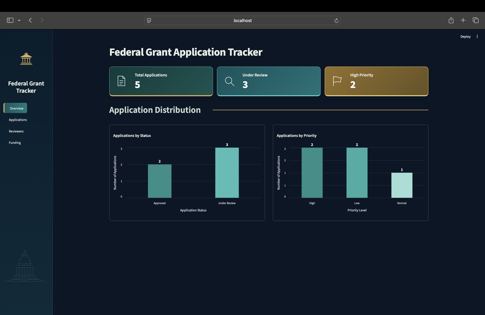
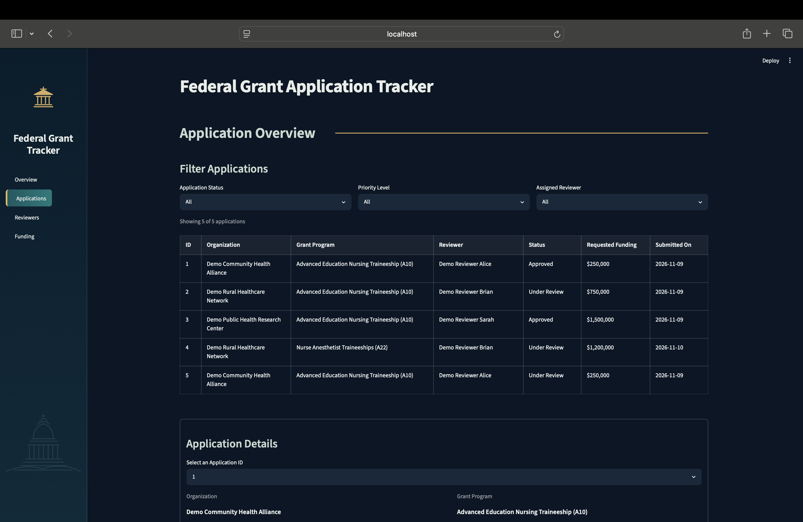
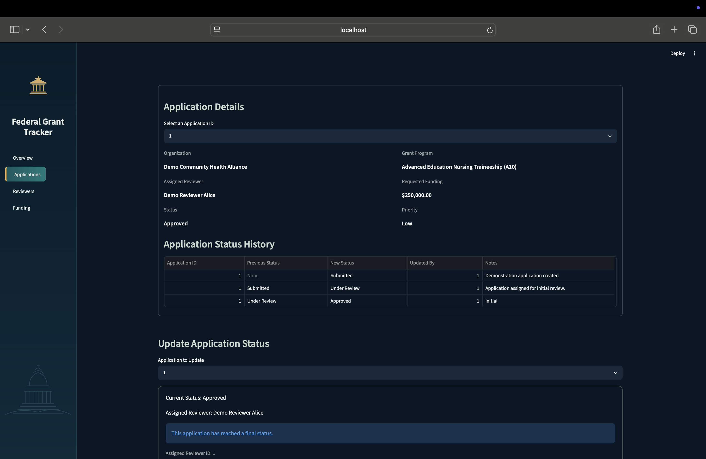
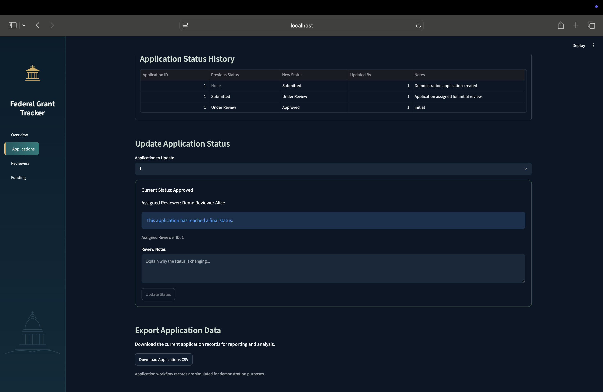
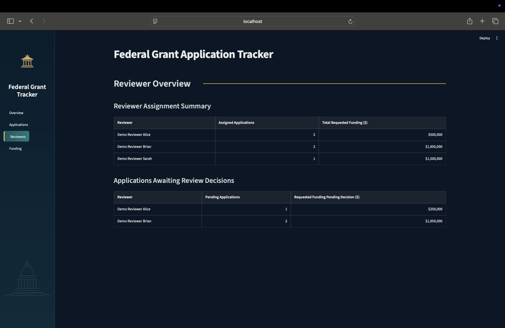
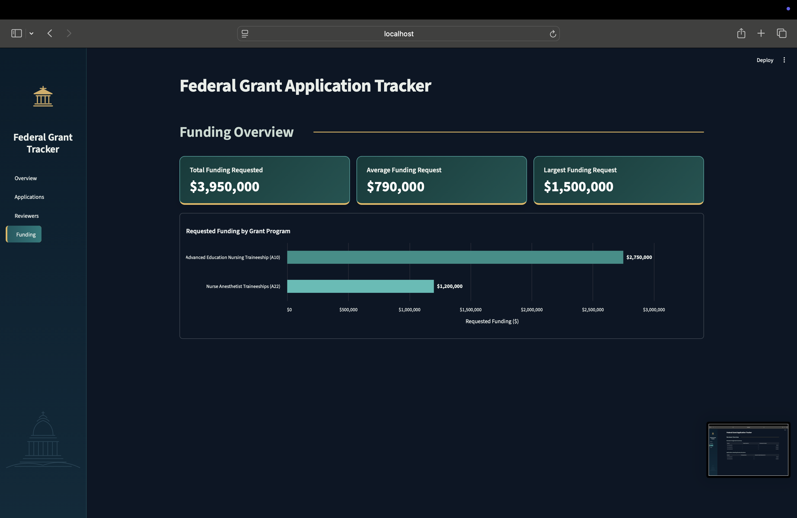

# Federal Grant Application Tracker

An interactive federal grant management dashboard built with **Python, Streamlit, SQLite, and FastAPI**. The project demonstrates application workflow tracking, reviewer management, funding analysis, and REST API development.

### Live Dashboard

**[View the Live Application](https://grant-applicant-tracker.streamlit.app)**

### GitHub Repository

[View Source Code](https://github.com/Kismail3/grant-applicant-tracker)

### Dashboard Overview

### Key Features

- **Application Tracking:** View applications, filter records, and explore application details.
- **Status Management:** Demonstrate application status transitions and review history.
- **Reviewer Analytics:** Monitor reviewer assignments and pending decisions.
- **Funding Analysis:** Visualize requested funding by grant program.
- **Interactive Dashboard:** Explore application statistics through charts and summary cards.

### Technologies Used

Python · Streamlit · FastAPI · SQLite · Pandas · Altair

### Data Disclaimer

The project uses real HRSA grant reference data alongside simulated application and reviewer workflows. The publicly deployed dashboard uses session-based status changes that do not permanently modify the underlying database.
